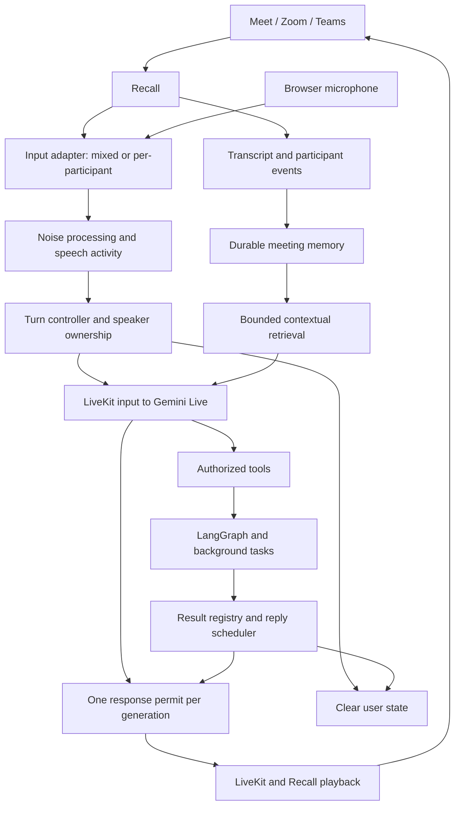

# خطة تحسين Meeting Voice Agent — مراجعة شاملة

**التاريخ:** 13 نوفمبر 2026. **الحالة:** دراسة وخطة تنفيذ، وليست تغييرات مطبقة أو ضمان أداء.

## تقدم التنفيذ — الدفعة الأولى، 13 نوفمبر 2026

بدأ تنفيذ الخطة محليًا. شملت الدفعة: حفظ final المتأخر لمداخلة معروفة دون تغيير الدور الحالي؛ إنهاء مرشح الكلام عند انتهاء النشاط أو انقضاء مهلة تأكيده دون إسكات المحادثة؛ منع إعادة تصريح الكلام لنفس تحديث الأداة؛ وتحديد سجل الأدوات المكتملة. أضيفت أسباب رفض الرد وبصمة كود وإعدادات غير سرية للسجلات.

التحقق لهذه الدفعة: 367 اختبارًا في تشغيل المجموعة الكاملة نجحوا؛ وبعد تحسين ترتيب الاحتفاظ بنتائج الأدوات نجحت 30 حالة مرتبطة، مع 8 اختبارات متصفح وفحص Ruff. بصمة كود التشغيل: `cd5b9a7f75c879d9ff26`. لم يُنفذ اجتماع فعلي في هذه الدفعة.

هذه ليست إكمالًا للخطة كلها. الربط الكامل بين generation والصوت، watchdog للطلب العالق، تجربة الصوت المنفصل، وقياس الأداء داخل اجتماع حقيقي ما زالت مراحل لاحقة. نتائج المراجعة أدناه تصف الحالة وقت التدقيق قبل هذه الدفعة؛ اختبارات الانحدار تحفظ الحالات التي أعيد إنتاجها.

## القرار الأساسي

الأولوية هي بناء إدارة موحدة لأدوار الكلام والمقاطعات، ثم تجربة صوت منفصل لكل مشارك. تحسين الـsystem prompt أو زيادة تنقية الضوضاء وحدهما لن يعالجا مشكلة تداخل المتحدثين وعدم الرد والتكرار.

نحتفظ بـGemini Live للصوت الطبيعي، وLiveKit للنقل، وRecall للانضمام والتفريغ، وLangGraph للأدوات. لا يوجد دليل حالي يبرر إعادة كتابة المشروع كله أو إزالة LiveKit لتحسين التأخير. التغيير يكون تدريجيًا، قابلًا للرجوع، وباختبارات صوت حقيقية بالإضافة إلى الاختبارات البرمجية.

**معنى النجاح:** يستجيب للنداء الصحيح، لا يرد على حديث جانبي، لا يتجمد بعد الضوضاء، يسمح بالمقاطعة المقصودة، ينجز الأدوات دون تعطيل الحوار، ويتذكر ما قيل مع مصدره وحدود دقته.

## نطاق المراجعة وحدود الأدلة

راجعت النسخة المحلية النشطة `meeting-voice-agent` بما فيها تعديلات الضوضاء والذاكرة الأخيرة؛ هذه النسخة ليست بالضرورة نفس النسخة المنشورة على GitHub. شملت المراجعة worker، gating، turns، recovery، personas، أدوات البحث والشات والشاشة، ذاكرة SQLite والأرشيف، الواجهة، التشغيل والتوثيق والاختبارات. لم أعدل كود التشغيل ولم أبدأ اجتماعًا أو تجربة مدفوعة أثناء الدراسة.

تصنيف الأدلة:

- **مؤكد:** سلوك ظاهر في الكود أو أعيد إنتاجه محليًا.
- **مرصود:** حدث موجود في السجلات، دون افتراض أنه السبب الوحيد للشكاوى.
- **فرضية:** تفسير يحتاج تجربة صوتية أو قياسًا قبل اعتماده.

فُحصت أحدث أربعة ملفات telemetry، وهي 80 و5 و155 و87 حدثًا. بدأت في 13 نوفمبر 15:05:42 و15:04:26 UTC، و12 نوفمبر 12:11:00 UTC، و11 نوفمبر 22:34:06 UTC، بمدد مرصودة 82.1 و70.7 و184.3 و63.8 ثانية. هذه فترات تسجيل وليست بالضرورة مدد الاجتماعات الكاملة. السجلات لا تحتوي على بصمة إصدار كافية لربط كل عينة بالكود الحالي.

في أحدث ملف ذي 80 حدثًا: ثلاث موافقات على الصوت مع انتظار gate بين 0 و0.1ms، ورفض واحد بعد 851.1ms. العينة لا تثبت أن gate هو مصدر كل التأخير، ولا أن زمن الرد الكلي جيد. في عينة 12 نوفمبر: 71 تحديث سياق خلال 184.3 ثانية وانتظار gate بلا حدث قرار مطابق. قد يكون الأخير أثر انقطاع أو نهاية التسجيل؛ ليس دليلًا منفردًا على deadlock.

اختبارات الجولة السابقة كانت مفيدة: المجموعة الكاملة أعطت 353 نجاحًا وفشلًا واحدًا في استرجاع الذاكرة، ثم أصلح الفشل ونجحت إعادة 89 اختبارًا مرتبطًا و8 اختبارات متصفح. لم أعد تشغيلها كلها لهذه الدراسة. لا تساوي هذه النتائج اختبار اجتماع حقيقي متعدد الأشخاص.

## ما هو جيد بالفعل ويجب الحفاظ عليه

- صوت أصلي مباشر من Gemini، من غير STT→LLM→TTS إلزامي لكل رد.
- تنقية WebRTC محلية وحساسية بداية كلام أقل، مع fallback إذا فشلت التنقية.
- تفعيل compression وsession resumption بالفعل؛ لا نعيد تقديم تفعيلهما كحل جديد.
- الأدوات تعمل خارج مسار فريمات الصوت، والتفريغ يُحفظ محليًا أثناء تعطل الـAPI.
- أسماء الشخصيات وأصواتها محددة، وتوجد حماية من إعادة صوت الشخصية القديمة عند التبديل.
- حماية إرسال الشات من الطلبات غير الموجهة ومن إعادة محاولة إرسال غامض.
- فصل السؤال عن تحديثات Recall المرجعية، والاحتفاظ بتفريغ المساعد والكلام المقطوع.

## النتائج ذات الأولوية

### F01 — تفريغ قديم قد يتحول إلى دور جديد | P0 | مؤكد بإعادة الإنتاج

المصدر: `app/agent/turns.py:52`. نفذت ترتيبًا اصطناعيًا: partial للمداخلة A، ثم partial للمداخلة B، ثم final متأخر لـA. النتيجة الحالية: قبول A كالمداخلة الحالية مرة أخرى وزيادة epoch. إزالة التكرار حسب ID لا تكفي لضمان ترتيب الأحداث.

**الأثر المحتمل:** إلغاء عمل مرتبط بالسؤال الأحدث، تغيير صاحب الدور، أو إعادة الرد على كلام قديم. هذه إمكانية مؤكدة؛ نسبة وقوعها في الاجتماعات غير مقاسة.

**المطلوب:** سجل utterances يفصل ترتيب الكلام عن وقت وصول التفريغ. final متأخر يحدث الذاكرة والمصدر فقط، ولا يفتح تصريح رد أو يلغي طلبًا أحدث. اختبار جميع تبديلات partial/final/reconnect لكل شخصين.

### F02 — انتظار التفريغ قد يبقى بعد ضوضاء | P0 | مؤكد بإعادة الإنتاج

المصدر: `turns.py:38` و`visual_replies.py:33`. استدعاء provider_started دون نص يترك awaiting_transcript=True حتى بعد رفض claim. هذا العلم ضمن شروط انشغال مسار رد الشاشة.

**الأثر:** يمكن أن تنتهي مهلة رد شاشة وهو ينتظر حالة غير مرتبطة بكلام حقيقي. لا يعني ذلك أن كل الصوت يتوقف دائمًا.

**المطلوب:** candidate speech له بداية ونهاية وسبب إغلاق؛ انتهاء VAD أو إلغاء النشاط بلا كلمات ينهي المرشح، ولا يُسكت المحادثة أو يعيد تشغيل الموديل. انتهاء مهلة طلب شاشة يجب أن يعطي نتيجة نهائية واضحة. اختبار ضوضاء ثم شاشة ثم سؤال عادي.

### F03 — إشعار أداة مكرر يمنح تصريح رد ثانيًا | P0 | مؤكد بإعادة الإنتاج، مع خطر سباق إضافي

المصدر: `gating.py:191` يعيد قراءة epoch بعد انتظار القرار، وهو خطر يحتاج اختبار ربط الصوت القديم. وفي `parallel_tools.py:87` أعدت إرسال نفس إشعار scheduled لنتيجة أداة، واستهلكت claim بعد كل مرة: النتيجة True ثم True. إعادة التصريح مؤكدة؛ وقوع إعادة الإشعار بهذه الصورة من المزود في الاجتماع الحالي غير مثبت بعد.

**المطلوب:** ReplyPermit مربوط بـsession + utterance + generation + request + persona_version، واستهلاك مرة واحدة لنتيجة بعينها. منع الصوت القديم من استخدام تصريح سؤال أحدث. لا نمنع تكرار جملة نصيًا على مستوى الاجتماع؛ قد يطلب المستخدم تكرارها فعلًا. اختبار audio-before-transcript، late results، duplicated callbacks، stop ثم wake، وتبديل الشخصية.

### F04 — المقاطعة ليست محكومة بالـprompt | P0/P1 | مؤكد معماريًا

المصدر: `worker.py:95` يستخدم allow_interruptions=True مع كشف Gemini. في وضع realtime يعتمد SDK على إشارة مقاطعة المزود؛ لا ينبغي افتراض أن إعدادات interruption الخاصة بمسار STT التقليدي ستعمل هنا. [مرجع LiveKit](https://docs.livekit.io/agents/logic/turns/).

**المطلوب:** تجربة منفصلة لسياسة المقاطعة على الموديل والإصدار المثبتين: ضوضاء أو «آه» من مستمع لا يقطعان الرد بسهولة؛ سؤال واضح أو طلب سكوت يوقفه بسرعة. مقارنة server VAD المضبوط مع manual activity control فقط إذا ثبتت الحاجة. لا نضع كاشفين متنافسين للنهاية بلا قياس، ولا نكتم الميكروفون طوال رد المساعد.

### F05 — صوت مختلط مع هوية متأخرة | P1 | مؤكد في المسار الحالي

المصدر: `static/media.js:124`، `integrations/recall.py:45`، `integrations/livekit.py:22`، `memory/live.py:142`. الإدخال المنشور للوكيل مسار واحد؛ لم تُضبط audio_separate_raw. هوية Recall تأتي كأحداث منفصلة، وآخر reported speaker ليس إثباتًا لهوية كل عينة صوت.

تنقية الضوضاء تقلل مروحة أو تشويشًا، لكنها لا تختار من يتكلم من وسط صوتين مفهومين. وأعلى صوت ليس دائمًا صاحب الطلب.

**المطلوب:** تجربة per-participant audio وطبقة اختيار صاحب الدور كما هو موضح أدناه. اسم الشخص يثري الرد؛ لا يكون شرطًا لتعطيل رد على سؤال واضح.

### F06 — النداء والفهم الدلالي غير موحدين | P1 | مؤكد مع أثر يحتاج تقييمًا

المصدر: `gating.py:41,65` و`personas.py`. النداء يعتمد على مطابقة أسماء، والمتابعة تعتمد على owner وآخر reported speaker. بعد تغيير الشخصية تتغير أسماء الاستدعاء، وقد لا يفهم المستخدم أنه يجب تغيير الاسم. ذكر اسم خالد في حديث عنه قد يشبه نداءه.

**المطلوب:** اسم استدعاء عام ثابت للمنتج بالإضافة إلى اسم الشخصية النشطة، بدون تبديل شخصية تلقائي لمجرد ذكر اسمها. التفريق بين نداء مباشر واقتباس أو حديث جانبي، والاستفادة من السياق والهوية. عند غياب الاسم أو خطأ ASR لا نضيف تخمينات واسعة ترفع الردود الكاذبة. نختبر بدائل wake detector أو STT قصير بالتوازي عند الضرورة فقط، لا استدعاء LLM إضافيًا لكل فريم.

### F07 — تحديث السياق قد يصبح مزعجًا للموديل | P1 | مرصود ومؤكد بنيويًا

المصدر: `memory/live.py:166`. تُضاف رسائل user مرجعية عند تغير البيانات؛ عينة 12 نوفمبر سجلت 71 تحديثًا خلال نحو 3 دقائق. هذا لا يثبت أنها سببت التكرار، لكنه يجعل churn واختلاط الرسائل بالسؤال الحقيقي أولوية قياس.

**المطلوب:** coalescing لتغيرات المشاركين، revision IDs، عدم إعادة transcript معروف، وتحديث عند تغير مفيد لا كل حركة speaker-off/on. عدم حقن metadata وسط الرد. نختبر الطريقة التي يدعمها SDK لتحديث السياق دون توليد؛ تغيير role إلى system وحده ليس علاجًا آمنًا.

### F08 — التخزين الكامل لا يساوي ذاكرة جيدة | P1/P2 | مؤكد

المصدر: `memory/context.py:21,62` و`archive.py:26,59`. الاسترجاع يقرأ كامل utterances ويرتبها ثم يقص النص؛ إعادة تصدير الأرشيف تقرأ التاريخ وتعيد كتابته. هذا نمو مع طول الاجتماع، وليس إثباتًا أنه سبب البطء الحالي. الحفظ يعتمد على التفريغ المستلم، لا تسجيل كل كلمة صوتية بدقة مضمونة.

**المطلوب:** سجل دائم كامل، سياق قريب محدود، ملخص تدريجي خارج الصوت، facts/decisions/action items بمراجع، واسترجاع مفهرس عربي/إنجليزي. لا نحذف حقيقة مهمة بسبب قص نهاية النص. لا نبدأ بقاعدة vectors قبل قياس فائدة بحث نصي مفهرس.

### F09 — ما نطق فعليًا يحتاج هوية مستقلة | P1 | خطر من الكود

المصدر: `worker.py:402` يستخدم published_audio كعلم عام لتسجيل نص المساعد. إرسال فريم إلى LiveKit لا يثبت أن المستخدم سمع كل الرد. مع interruption أو تبديل شخصية قد تختلف generated/published/played.

**المطلوب:** لكل رد speech_id وشخصيته ونصه المتوقع والمنشور والمقطوع، وplayout acknowledgment حيث يتاح. بدون acknowledgment نكتب «أرسل للتشغيل» لا «سمعه الجميع». هذه البيانات تمنع إعادة الجزء المسموع وتمكّن استكمالًا صحيحًا عند طلب المستخدم.

### F10 — الشاشة والأدوات تحتاجان حالات نهاية موحدة | P1 | مؤكد جزئيًا

المصادر: `visual_replies.py:25`، `parallel_tools.py:12`، `screen_tools.py` و`screen/workflow.py`. رد الشاشة له انتظار يصل إلى 30 ثانية، وقبول صورة في النقل لا يثبت أن الرد استند إليها. توجد telemetry لنهاية الطلب الآن؛ لذلك ملاحظة التدقيق القديم عن غيابها بالكامل لم تعد دقيقة. سجل calls المكتملة ما زال بلا pruning واضح.

**المطلوب:** كل tool request ينتهي بـcompleted/failed/cancelled/superseded، مع سبب ونتيجة واحدة قابلة للتقديم. الصورة ترتبط بسؤال وframe_id وعمر ومقدم. لا نستبدل الجواب بـ«براجع الشاشة» متكررًا. نتائج الخلفية تنتظر الدور المناسب؛ لا تقطع سؤالًا أحدث ولا تنطق بعد طلب السكوت. prune محدود للسجلات المكتملة مع حفظ معرفات منع التكرار.

### F11 — الشخصية والهوية المرئية غير متطابقتين دائمًا | P2 | مؤكد

المصدر: `persona_switch.py:17` و`voice/recovery.py:45`. التبديل ينتظر final لفترة قصيرة، بينما final قد يتأخر مع سلوك المزود، ثم يحتاج اتصال Gemini جديدًا بمهل انتقال/rollback. اسم بوت الاجتماع ثابت، والشات التلقائي له مسار مستقل.

**المطلوب:** تعريف واضح: بوت واحد، شخصية صوتية نشطة واحدة. إظهار الشخصية في الواجهة وسجل الاجتماع، وعدم ادعاء تغيير اسم roster غير المدعوم. اختبار التبديل المتتالي وأثناء أداة أو مقاطعة، وضبط binding للطلب بدل إطالة انتظار final عشوائيًا. تحديد هل الشات يتبع الشخصية أم هو Khaled مستقل؛ الأفضل توحيدها مع الاحتفاظ بشخصية وقت إنشاء كل رسالة.

### F12 — التعافي لا يقاس بصمت المستخدم | P0/P1 | حاجة تصميم مؤكدة

المصدر: `voice/network.py:36` يلغي ping timeout المحلي، و`input_health.py` يرصد PCM والطاقة، لكن الطاقة ليست فهمًا للكلام أو وصول رد مفيد. إزالة timeout تجنبت انقطاعًا، لكنها لا تغني عن كشف اتصال حي ظاهريًا لا ينجز طلبات.

**المطلوب:** watchdog يتابع طلبًا مقبولًا ينتظر نتيجة، عمر audio/input queues، آخر provider progress، event-loop lag، وRTC connection. السكوت 60 ثانية أو 5 دقائق لا يبدأ reconnect. الطلب العالق يبدأ تشخيصًا ثم recovery محدودًا مع حفظ السياق، بلا إنشاء بوت ثانٍ أو إعادة أدوات ذات آثار جانبية. [إدارة جلسات Gemini](https://ai.google.dev/gemini-api/docs/live-api/session-management).

### F13 — واجهة توضح الاتصال أكثر مما توضح الموقف | P2 | مؤكد

المصدر: `static/app.js` و`media.js`. توجد رسائل اتصال وتعافٍ، لكن المستخدم يحتاج تمييز «متصل» عن «يسمعني» و«ينتظر نداء» و«ينفذ مهمة» و«فشل الصوت».

**المطلوب:** حالة بسيطة بجوار الدائرة، الشخصية الحالية، نشاط إدخال/إخراج منفصل، اختيار الميكروفون واختباره، transcript اختياري، مهام الخلفية، وزران منفصلان «اسكت واستمع» و«اخرج من الاجتماع». شاشة الجلسات تعرض جلسة نشطة بعد غلق CMD، وإعادة الاتصال لا تنشئ اجتماعًا جديدًا. دعم العربية/RTL، لوحة المفاتيح، contrast، reduced motion، وإخفاء الأخطاء التقنية خلف تفاصيل دعم قابلة للنسخ.

### F14 — نسخة شركة متعددة الاجتماعات تحتاج طبقة تشغيل | P2/P3 | مؤكد كفجوة توسع

المصدر: `main.py:108,147`، SQLite lock، `screen/receiver.py`، وDockerfile. مفتاح إدارة مشترك مناسب لتجربة محلية لكنه ليس عضوية وصلاحيات فرق. الشاشة لها queue/executor مشتركان وحد اتصال حالي؛ تشغيل عدة API workers بدون توزيع ملكية الجلسات ليس توسيعًا آمنًا. Dockerfile يشغل API؛ خطة النشر تحتاج worker منفصلًا أيضًا.

**المطلوب:** tenant/team/session ownership، worker affinity، حدود موارد لكل جلسة، queue للأعمال الخلفية، persistent storage ونسخ احتياطي واختبار استعادة، deployment يضم API+workers، وadmission control. اختيار Postgres/خدمة queue عند الانتقال الفعلي لعدة instances؛ لا نعيد بناء النسخة المحلية بلا حاجة. نقل الصوت أو decoding خارج مشاركة CPU قد يكون ضروريًا عند إثبات الضغط.

### F15 — الأمان والتكلفة جزء من تجربة المستخدم | P2/P3 | فجوات منتج

**المطلوب:** صلاحيات لعرض التفريغ والتحكم والإرسال، عزل الفرق، signed endpoints، سرية المفاتيح، حدود payload/rate، عدم تنفيذ أوامر داخل صور أو transcripts كتعليمات للمساعد، سجل أحداث إداري، retention قابل للضبط وحذف يشمل outbox/archives/backups وفق السياسة. الموافقة على حضور وتفريغ الاجتماع لا تُستبدل بافتراض تلقائي عند مشاركة الرابط.

Telemetry الحالية تحفظ حقول زمنية للمزود دون عدادات tokens كافية. نحتاج usage لكل session/team يفصل الاستماع والرد والصور والبحث والتفريغ، وreconciliation مع الفواتير. لا نستنتج أن الصمت مجاني، ولا أن فصل المسارات يوفر التكلفة تلقائيًا. نضع ميزانية وتنبيهًا وحدًا متفقًا عليه بدل قطع الصوت فجأة.

## تصميم التعامل مع عدة متحدثين

Recall يوثق realtime separate audio على Meet وZoom وTeams، بصوت PCM mono 16kHz مرتبط بالمشارك، وبحد يصل إلى 16 متحدثًا متزامنًا. يتطلب audio_separate_raw وWebSocket endpoint؛ صوت مشاركة الشاشة غير مشمول حاليًا في هذا المسار. هذا دعم موثق، وليس تحققًا أن حسابنا ومنصات عملائنا نجحت به. [مرجع الصوت المنفصل](https://docs.recall.ai/docs/how-to-get-separate-audio-per-participant-realtime).

الفصل حسب participant لا يفصل شخصين يستخدمان نفس الميكروفون. وثائق Recall تميّز ذلك عن diarization لعدة أشخاص في جهاز واحد؛ hybrid diarization المذكور هناك ليس حلًا realtime حاليًا. [مرجع هوية المتحدث](https://docs.recall.ai/docs/diarization).

التجربة المقترحة:

1. إبقاء المسار الحالي كـbaseline، وإضافة input adapter خلف feature flag. الإخراج يظل عبر LiveKit/Recall. لا يُرسل المسار المختلط والمسار البديل إلى Gemini في الوقت نفسه.
2. لكل participant: queue محدودة، timestamps، كشف كلام، denoising اختياري، ومخزن صوت قصير قبل بداية الكلام لحماية أول كلمة. نختبر 100–300ms بدل اختيار قيمة على أنها الأفضل مقدمًا.
3. Floor manager يقرر من له الدور: نداء واضح، متابعة موجهة من صاحب الدور، مقاطعة مقصودة، حديث جانبي، أو تداخل غير مفهوم. آخر اسم متحدث أو أعلى طاقة وحدهما لا يكفيان.
4. عند تداخل طلبين: لا نمزج السؤالين في سؤال وهمي ولا نشغل صوتين؛ نعالج طلبًا واضحًا ونحتفظ بالآخر كتدخل يحتاج ترتيبًا، أو نسأل مرة واحدة من يبدأ إذا تعذر الفهم.
5. لا نضيع باقي الاجتماع: مسار تفريغ جميع المتحدثين يذهب للذاكرة خارج المسار السريع. نثبت أن تغيير الصوت المختار لا يخفي معلومة ضرورية. منع رجوع صوت البوت من ميكروفونات الحضور يحتاج اختبار echo؛ source ID وحده لا يعالج هذا النوع من الصدى.
6. لا ننشئ جلسة Gemini مدفوعة لكل مشارك افتراضيًا. نقارن خيار توجيه الصوت مع كاشف نداء/مقاطعة متوازٍ محدود، ونقيس فهمه وزمنه وتكلفته. يجب أن يستطيع شخص جديد نداء المساعد أثناء دور آخر؛ ليس مجرد إسكات كل المسارات غير المختارة.
7. fallback تلقائي مدروس للمسار المختلط إذا انقطع receiver، مع إخطار مختصر وبدون تغذية مزدوجة. ظهور جودة أسوأ أو فقدان الكلام يوقف تعميم التجربة.

## البنية المستهدفة

الـcontroller سريع ومحلي ولا ينتظر شبكة داخل مسار PCM. LangGraph يبقى لتنظيم العمل والنتائج، وليس للفصل بين كل فريم صوتي. نفس منطق الدور يستخدم في الموقع والاجتماعات؛ الاختلاف input adapter ومعلومات المشاركين فقط.

العقود الأساسية: utterance_id، participant_id أو unknown، source_timestamp، revision، generation_id، persona_version، request_id، status، reason. تحديث المعرفة شيء، منح حق الكلام شيء آخر. تشغيل أداة شيء، إثبات وصول نتيجتها أو رسالة الشات شيء آخر.

## أهداف القياس والقبول

الأرقام التالية **أهداف هندسية مبدئية للتجربة**، وليست نتائج حالية أو SLA للمزود. نثبتها بعد baseline، ونقسم النتائج حسب المنصة واللغة والجهاز والضوضاء، بدل متوسط يخفي المشكلات.

- الرد العادي دون أدوات: من نهاية كلام الشخص إلى أول صوت مسموع على جهاز مشارك، p50 ≤1.5s وp95 ≤3s وp99 ≤5s. نستبعد البحث من هذه الفئة ونعرضه منفصلًا. لا نحسب acknowledgment كإجابة شاشة أو بحث ناجحة.
- النداء: استجابة ≥98% في الهدوء، و≥95% في ضوضاء متوسطة معرفة بعينات ثابتة. نبدأ بـ200 نداء على الأقل، ونحسب أيضًا false activation على 500 مقطع سلبي و10 ساعات حديث جانبي؛ هدف أولي ≤تنشيط كاذب واحد/ساعة. نعرض حجم العينة وفاصل الثقة، لا النسبة وحدها.
- المقاطعة المقصودة: توقف التشغيل p95 ≤500ms بعد اكتشاف الطلب؛ نسجل أيضًا الزمن من بداية الأمر الصوتي حتى التوقف حتى لا نخفي تأخر الكشف. نسبة قطع الرد بسبب backchannel/ضوضاء مستهدفة <2% من الحالات الموسومة.
- التكرار: صفر آثار جانبية مكررة في اختبارات replay؛ والردود المكررة بلا مداخلة جديدة <0.5% من الأدوار في pilot. نميز طلب «عيد الكلام» عن العيب.
- التعافي: لا فصل بسبب السكوت وحده؛ لا طلب مقبول يبقى بلا حالة نهائية. هدف تعافٍ p95 ≤10s عند عطل قابل للتعافي، دون وعد باستعادة شبكة خارج الخدمة. تجربة ساعتين، ثم 5 ساعات متصلة.
- الذاكرة: حفظ كل الأحداث النهائية المستلمة بعد تصريف outbox، وتطابق أعداد ومعرفات السجلات عبر restart. استرجاع الحقيقة المطلوبة مع مصدرها ≥90% على 100 سؤال عربي/إنجليزي موسوم. التقاط كل الكلام صوتيًا يقاس منفصلًا بـASR WER/CER والإسناد، لا بعدد السجلات.
- الشاشة: إجابة صحيحة على محتوى جديد ≥95% في مجموعة slides/code/screenshots مقروءة؛ لا إجابة من frame قديم بعد تغيير المشاركة. هدف أولي p95 ≤6s للجواب المستند للصورة، ويثبت تجريبيًا.
- السعة: نقيس 1 ثم 5 ثم 10 ثم 25 جلسة متزامنة، وبعدها السعة المطلوبة فعليًا. تسجيل CPU/RAM/loop lag/queue age/provider quotas وزمن الرد لكل درجة. لا نعلن دعم 25 اجتماعًا بناء على اختبار API فقط.

يجب أن يتضمن trace واحد مراحل: التقاط الصوت، دخوله الخادم، بداية/نهاية النشاط، تفريغ جزئي، قرار الدور وسببه، وصول أول صوت من المزود، خروج الصوت من التطبيق، ثم playout. نقارن ساعات monotonic داخل العملية نفسها فقط؛ قياس النهاية للمستخدم يحتاج probe واحدًا أو معايرة clock offsets. نسجل build/config/model versions دون مفاتيح أو محتوى حساس افتراضيًا.

## خطة التنفيذ والأولويات

### المرحلة 0 — تثبيت خط أساس قابل للمقارنة | 2–3 أيام عمل

مالك: backend/voice engineer مع QA. حفظ release baseline وخيارات feature flags، ربط IDs والـlatency stages، تجهيز سيناريوهات صوتية مسموح استخدامها، وتحديد عدد الاجتماعات المتزامنة المطلوب وأجهزة العملاء والمنصات. مراجعة health endpoints لتمييز API alive عن voice ready. تجربة واحدة لكل منصة مع تسجيل النتيجة الفعلية.

**شرط الانتقال:** يمكن تفسير عدم الرد بسبب محدد: no audio، no speech، wake rejected، owner mismatch، stale input، provider delay، tool wait، أو playback failure. لا يكفي «Agent state: listening».

### المرحلة 1 — إيقاف التجمد والتكرار | 4–6 أيام

مالك: voice/backend. تنفيذ F01–F03 وF12 أولًا: utterance ledger مرتب، انتهاء candidate speech، تصاريح مرتبطة بالجيل، نتائج أدوات idempotent، reason codes وwatchdog لا يتعامل مع السكوت كعطل. المحافظة على النداء الطبيعي وstop وبقاء المحادثة بعد الصمت.

**شرط الانتقال:** اختبارات late final/duplicate callback/noise→silence/stop→wake/reconnect/أداة متأخرة كلها ناجحة، مع zero duplicate send في fault tests، وعدم تراجع الموقع عن baseline.

### المرحلة 2 — تحسين الاستماع والمقاطعات | 5–8 أيام

مالك: voice engineer وQA صوتي. تجربة الصوت المنفصل على المنصات الثلاث، floor manager، قياسات VAD والضوضاء والـecho، وتقييم أسماء الاستدعاء بعد تبديل الشخصية. التبديل بين mixed/separate خلف feature flag لكل جلسة، لا rollout شامل.

**شرط الانتقال:** تحسن مثبت في wake recall وfalse interruption وفهم التداخل دون تراجع زمن الرد أو فقدان بقية كلام الاجتماع من الذاكرة. النداء من شخص غير صاحب الدور يعمل أيضًا.

### المرحلة 3 — الفهم والذاكرة والأدوات | 5–7 أيام

مالك: backend/agent engineer. bounded retrieval وفهرسة أولًا، ثم ملخصات incremental موثقة لا تعيد صياغة الاتفاقات كحقائق جديدة، وتحديثات metadata مجمعة، وربط الرد المسموع بالهوية. توحيد request lifecycle للبحث والشات والشاشة وإدارة النتيجة بعد تغير الموضوع أو الشخصية. إعادة كتابة prompt لتقليل التعارض والتكرار، واختبار المعنى بدل قوائم عبارات محفوظة.

**شرط الانتقال:** أسئلة الإحالة «ابعتها هناك/نفس اللي قولناه/كنت اتفقت مع مين» تنجح بعينات موسومة؛ نتيجة الشات لا تعلن delivered قبل إثبات المزود؛ الشاشة لا تؤخر السؤال العادي التالي؛ لا استرجاع من اجتماع آخر.

### المرحلة 4 — واجهة منتج وتشغيل متعدد الفرق | 7–10 أيام

مالك: frontend + backend/infra، ويمكن تنفيذ الواجهة بالتوازي بعد استقرار عقود الحالة. صفحة جلسات وأزرار واضحة وreconnect/leave، صلاحيات فرق، تخزين وخدمات إنتاج، queue/admission control، لوحة تكلفة وتشخيص، backup/restore، وقياسات سقف التزامن.

**شرط الانتقال:** غلق CMD لا يترك المستخدم بلا تحكم؛ صلاحيات الاجتماعات معزولة؛ فقدان worker لا ينشئ بوتًا مكررًا؛ جلسة كثيرة الأدوات لا تستنزف ذاكرة غير محدودة. لا زيادة uvicorn workers قبل حل ملكية الحالة والـscreen buffers.

### المرحلة 5 — قبول تجريبي وإطلاق تدريجي | 5–8 أيام

مالك: QA مع مالك المنتج. replay/offline ثم sandbox meetings، ثم pilot داخلي محدود، ثم rollout 10%→25%→100% حسب gates. إجراء soak ومقاطعات وشبكة ضعيفة وتغيير أجهزة، واختبار المنصات على حسابات المؤسسة الفعلية.

**شرط الإطلاق:** نجاح معايير القبول المتفق عليها، وثائق دعم مختصرة، rollback مجرّب، ونتائج مصنفة حسب المنصة واللغة. أي زيادة كبيرة في misses أو duplicate actions أو p95 توقف التوسع وتعيد flag السابق.

التقدير الإجمالي التقريبي 28–42 يوم عمل، أي نحو 6–9 أسابيع لمسار يقوده مهندس أساسي مع دعم QA/frontend/infra. ليس موعد تسليم ملزمًا؛ تكامل المنصات وقيود الحسابات قد يغيرانه. أول تحسن عملي مستهدف في المرحلة 1، وليس انتظار اكتمال كل مراحل الشركة.

## مصفوفة الاختبار العملية

- شخص واحد هادئ: نداء عربي وإنجليزي، تردد، جملة طويلة، توقف داخل الجملة، همس وصوت منخفض، ثم صمت 60 ثانية و5 دقائق.
- شخصان: سؤال ثم تدخل جانبي، نداء من الشخص الثاني أثناء الرد، اختلاف ترتيب وصول metadata والصوت، ومقاطعة مقصودة وغير مقصودة.
- 4–8 مشاركين: ثلاثة يتداخلون، ميكروفون غرفة مشتركة، شخص يغادر ثم يعود، اسم مكرر، مشارك بلا اسم، وصدى من مكبر صوت.
- ضوضاء: لوحة مفاتيح، مروحة، طرق، سعال، ضحك، تلفاز فيه كلام. فصل noise عن background speech في التقييم؛ الأخير ليس صمتًا.
- فهم: نفي واقتباس وذكر اسم غير موجه، code-switching، أسماء مشروعات، تواريخ وأرقام، وطلب «عيد آخر جملة».
- أدوات: بحث طويل مع استمرار الحوار، إلغاء صريح، توقف صوت دون إلغاء المهمة، فشل شبكة بعد قبول إرسال، callback مكرر، نتيجة بعد سؤال أحدث.
- شاشة: صورة جديدة برمز عشوائي، تغيير العرض أثناء المعالجة، توقف مشاركة، نص صغير، صورة تحتوي تعليمات خبيثة، ثم سؤال صوتي عادي مباشرة.
- شخصيات: 20 تبديلًا متتابعًا، طلب تبديل منفي، final متأخر، rollback، وتحديد الشخصية عند تسجيل الرد أو إرساله للشات.
- تعافٍ: انقطاع RTC وGemini والـAPI كل واحد مستقلًا، crash بعد حفظ event وقبل إرساله، امتلاء queue، فقد packets، latency/jitter، quota exhaustion، وإغلاق النافذة.
- ذاكرة: ساعة وساعتان وخمس ساعات، 1k/10k/100k سجلات للاختبار المحلي، تصحيح متحدث، طلب حذف، وإعادة بناء الأرشيف من SQLite.

تستخدم ground truth موسومة: من تكلم، هل كان يقصد المساعد، هل كان الكلام مفهومًا، هل المقاطعة مقصودة، وما الجواب المتوقع. تقييم البشر للملاءمة والطبيعية جزء أساسي؛ نجاح assertions وحده لا يقيس تجربة الحديث.

## قرارات لا نعتمدها قبل تجربة

- عدم إزالة LiveKit أو نقل PCM إلى LangGraph لمجرد أن هناك تأخيرًا.
- عدم فتح Gemini session لكل مشارك أو لكل شخصية دون تكلفة وlatency واضحين.
- عدم تشغيل الاستماع/الصور المدفوعة الإضافية لكل اجتماع تلقائيًا.
- عدم فصل الصوت بمجرد انتهاء timer للصمت، أو إضافة «أنا معاك» دوريًا لإخفاء المشكلة.
- عدم خفض مهلة انتهاء الكلام عشوائيًا؛ يمكن أن يقص جمل العربي ويضاعف المقاطعات.
- عدم استخدام text dedup شامل يحذف جملة قالها شخص آخر فعلًا.
- عدم تقديم full transcript كـprompt متجدد في كل turn، أو حفظ «ملخص» بلا إحالات بدل الأصل.
- عدم إضافة MCP أو تبديل المزودين ضمن هذه الخطة قبل تثبيت تجربة الصوت الأساسية.

## أول دفعة تنفيذ موصى بها

ابدأ بالمرحلتين 0 و1، وبثلاثة اختبارات فشل: final قديم بعد سؤال جديد، noise بلا transcript ثم طلب شاشة، وtool callback مكرر بعد أول جواب. بعدها نفذ تجربة صوت منفصل محدودة. هذا الترتيب يعالج عيوبًا مثبتة أولًا، ويمنع أن يخفي تغيير معماري كبير المشكلة أو يضيف تأخيرًا جديدًا.
