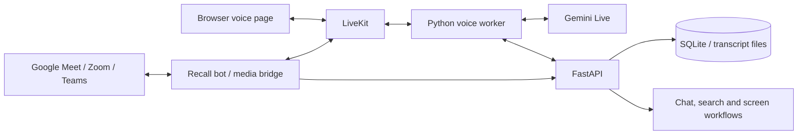

# Meeting Voice Agent

Khaled is a realtime AI assistant for Google Meet, Zoom, Microsoft Teams and browser voice conversations.
He speaks Arabic and English, answers questions, searches the web, uses meeting
chat and understands shared screens when asked.

## Quick start (Windows)

Requirements: Python 3.11+ (3.13 recommended), Google Gemini API access and a
LiveKit project. Meeting platforms additionally need Recall.ai and ngrok.

1. Run `Run-Agent.cmd`. On first use it creates `.env` and prompts you to fill in credentials.
2. Configure Google and LiveKit values in `.env`, then run the command again.
   Dependencies are installed automatically on the first configured run.
3. Open **http://localhost:8000**, start a conversation and allow microphone access.
   Headphones are recommended.

Keep the command window open while using the assistant.

## Configuration

Use [.env.example](.env.example) for available settings. Keep your real `.env` local.

- **Browser voice:** `GOOGLE_API_KEY`, `LIVEKIT_URL`, `LIVEKIT_API_KEY`, `LIVEKIT_API_SECRET`.
  The launcher generates `ADMIN_API_KEY` and `BRIDGE_SIGNING_SECRET` on first setup.
- **Meeting platforms:** `RECALL_API_KEY`, `RECALL_WEBHOOK_SECRET`, `RECALL_REGION`,
  `NGROK_AUTHTOKEN` and `PUBLIC_BASE_URL` (your ngrok HTTPS origin).
- **Web search:** `TAVILY_API_KEY`.
- **Screen understanding:** set `SCREEN_ENABLED=true`, `VISION_ENABLED=true` and
  `VISION_PASSIVE_ENABLED=false` for analysis only when requested. Provider charges apply.

Defaults: Gemini Live `gemini-3.8-live`, API `v1beta`, voice `Iapetus`,
languages `ar,en`. Restart services after changing configuration.

## Join a meeting

Supported links: canonical Google Meet links, Zoom `/j/<meeting-id>` links (including
`pwd`), and Teams `/l/meetup-join/...` or `/meet/<id>` links. Host admission and
organization recording/chat policies still apply. Provider support is not a guarantee
that a particular organization's meeting will admit the bot.

### Command-line meeting launcher

1. Run `Join-Meeting.cmd` and paste the Google Meet, Zoom or Teams URL.
2. Admit Khaled if the meeting asks. Participants must consent to the assistant and transcription.
3. Call **Khaled / خالد** to start talking to him. He keeps listening for follow-up
   questions from the activated caller across pauses. Ask him to be quiet to return
   to listening-only mode; call his name again when needed.
4. Press **Ctrl+C** in the meeting window to leave.

The window displays conversation, participant names, tool activity and available
latency diagnostics. Examples:

- “يا خالد، ابحث عن الموضوع ده وابعت النتيجة في الشات.”
- “What did we decide earlier?”
- “بص على الشاشة اللي مشاركها وقولي إيه الموجود.”

Research and chat tasks run in the background while voice remains available.
Screen images are sent for requested analysis; receiving a share does not trigger
continuous analysis. Silence does not itself end the conversation; the configured
session lifetime still applies (`SESSION_MAX_SECONDS`, default two hours).

## Speech reliability and memory

Audio passes through local WebRTC noise suppression before Gemini Live's
lower-sensitivity speech detector. This adds no separate AI service or turn-ending
wait. Set `VOICE_NOISE_SUPPRESSION=false` to bypass the denoiser if needed.
It reduces background noise; it cannot isolate overlapping speakers in a mixed
meeting track. Speaker names still come from Recall, without blocking replies.

Late final transcripts for an earlier known utterance update stored memory without
replacing the current question. Unconfirmed speech activity ends with the provider's
speech-end event or a bounded candidate timeout; this never silences the conversation.
Repeated tool-result notification IDs cannot grant a second spoken response.
Diagnostics include a source revision and gate rejection reasons without credentials.

Activity hints and duplicate transcript callbacks do not authorize another reply.
A fresh spoken request or an authorized tool result is required. Silence keeps
the active conversation open without generating repeated offers of help.

All received final speech transcripts and published assistant transcripts are kept
in SQLite and `data/transcripts/<session-id>.jsonl` / `.txt`, including persona,
source and interrupted status. Native ASR and Recall are labeled as separate
hypotheses where attribution is uncertain. The local outbox keeps writing during
API outages and replays with stable IDs after recovery. Observation timestamps are
preserved. `meeting_context` retrieves older discussion; it does not resend the
entire meeting every turn. Retention still follows `RETENTION_DAYS` (30 by default).
This saves received text, not a guarantee that ASR recognized every spoken word.

## How it works

### Voice personas

Every new voice runtime starts as **Khaled (Iapetus)**. The other roles are
**Mariam (Kore)**, an involved client in a role-play; **Youssef (Charon)**, a practical
project manager; and **Adam (Puck)**, an analytical technical lead. They share the
meeting context and tools but have distinct Egyptian Arabic conversational styles.
Mariam's approvals are simulated feedback, not real organizational authorization.

Ask naturally: “يا خالد هات مريم”, “خلينا نسمع رأي آدم”, or “يا مريم رجعيني لخالد”.
The Live model interprets the request and calls a guarded switching tool; mentioning
a name or a persona recommending a colleague does not itself switch roles. After a
successful switch, use the active persona's name to wake it. Silence does not stop
the conversation; an explicit stop still returns it to listening only.

Switching keeps the Recall bot, LiveKit room and conversation history. Only the
Gemini connection restarts with the new voice and prompt. A switch can introduce
a connection pause (12-second setup deadline, plus up to 12 seconds for rollback).
Actual latency and expressive delivery require a live listening test; naturalness
is prompted, not guaranteed. Ordinary turns do not add a separate routing-model call.
Failures retain the previous identity and attempt to restore its voice. A complete
network outage can still prevent recovery. Restarting a worker starts as Khaled.

Requested voices `Nika` and `Koda` were not in the installed Gemini Live catalogue;
the user approved `Kore` and `Charon` instead. No silent substitutions are made.
Reference: [Google Live voice documentation](https://docs.cloud.google.com/gemini-enterprise-agent-platform/models/live-api/configure-language-voice).
Persona definitions: `app/agent/personas.py`; switch guard: `app/agent/persona_switch.py`.
Spoken replies are archived with the active persona's name. The existing independent
automatic text-chat responder remains Khaled; spoken persona switching controls voice.

### Runtime



Gemini Live handles native audio. LiveKit transports it. Recall connects the bot
to the meeting platform and supplies meeting events/media. LangGraph orchestrates tools, outside
the audio stream.

## Project files

- `app/agent/` — voice worker, wake/stop handling and tool coordination.
- `app/voice/` — realtime transport, recovery and audio diagnostics.
- `app/workflows/` — LangGraph search, chat operations and research-to-chat.
- `app/screen/` — screen capture, frame cache and visual workflows.
- `app/meeting/` — meeting events and chat handling.
- `app/memory/` and `app/storage/` — context, transcripts and SQLite.
- `app/main.py` — FastAPI endpoints and background services.
- `prompts/` — conversational persona and local/meeting policies.
- `static/` — voice page and Recall browser bridge.
- `scripts/` — launchers and diagnostics; `tests/` — regression tests.

## Logs and troubleshooting

Runtime files are under `data/`: `meeting-services.log`, `meeting-tunnel.log`,
`latency-*.jsonl` and per-session transcripts in `transcripts/`.

- **No sound:** check microphone permission, browser playback and service logs.
- **No meeting response:** call Khaled by name and check that input audio reaches the worker.
- **Screen unavailable:** confirm both screen switches, active sharing and fresh frames.
- **Connection interrupted:** recovery retries automatically; inspect logs if it persists.
- **Port 8000 occupied:** close the previous launcher before starting another instance.

Latency logs exclude actual Google Meet speaker playback. A successful tool call
or local image enqueue does not prove the participant heard or saw the result.

## Development

From the project directory after setup:

```powershell
.venv\Scripts\python.exe -m pytest -q
.venv\Scripts\python.exe -m ruff check .
node --test tests/browser/audio_continuity.cjs
```

Node.js is needed only for browser regression tests. Provider probes are separate
from offline tests and can incur charges. Historical investigations are in `docs/`.
