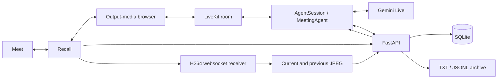
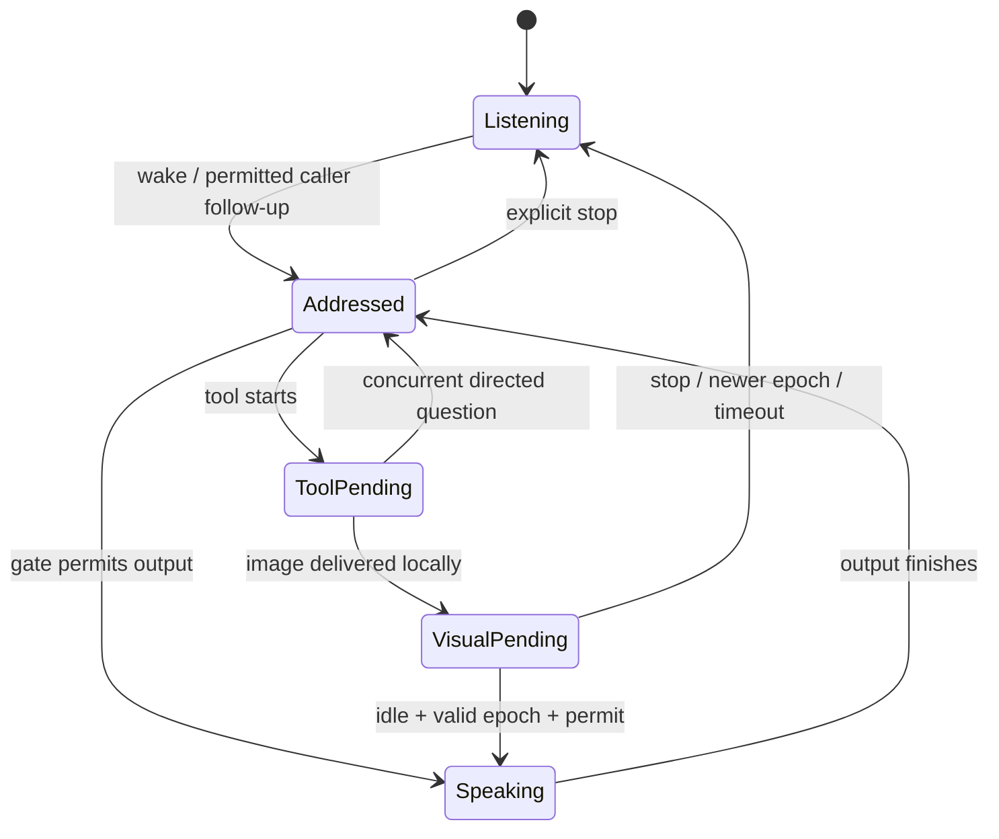

# System model — 10 November 2026

## Scope and evidence rules
VERIFIED means inspected code, recorded artifact, or cited documentation; it does not mean production acceptance. INFERRED means a reasoned consequence requiring measurement. GUESS means untested hypothesis. No provider calls or application edits were made for this audit. Historical observations span several implementations and must not be treated as a benchmark of the current checkout.

Coverage limitation: this is a focused architecture review, not an exhaustive line-by-line certification. Screen transport, scheduling, recovery, context composition and launchers received direct inspection. Other subsystems below are mapped at their integration boundaries; every possible lock/await and every historical report has not been independently validated. Do not interpret this document as completion of that exhaustive requirement.

## Actual runtime model
VERIFIED: `app/agent/worker.py:create_model`, `audio_room_options`, `MeetingAgent`; `app/main.py:lifespan`; `static/media.js:AudioConnection`.

VERIFIED: native audio uses 16 kHz mono input in 20 ms frames and 24 kHz mono output (`worker.py:73`). The realtime model has automatic VAD, input/output transcription, sliding-window compression and session resumption (`worker.py:52`). It is not an STT-text-TTS pipeline. LangGraph is outside the audio frame path. Local and meeting modes share the model factory; meeting mode adds wake gating and tools.

VERIFIED: audio transport reaches the SDK realtime session; `RecoveringRealtimeSession.push_audio` observes metadata and delegates to the SDK. `MeetingAgent.realtime_audio_output_node` gates generated audio before handoff. Recall playback and actual participant acoustics are additional hops beyond the bridge latency observer.

## Control and shared state
VERIFIED: `app/agent/gating.py:ResponseGate` owns decision event, epoch, stop serial, caller/follow-up state and output permits. `app/agent/turns.py:VoiceTurns` tracks transcript/tool continuation. `ParallelTools.calls` tracks operation status and captured epochs. `RecoveringRealtimeSession._native_tool_bindings` maps provider calls to application completion. `VisualReplies.tasks` owns delayed visual speech. These are separate mutable owners, not one transactional state machine.

VERIFIED: a visual answer waits for user not speaking, agent listening, no pending transcript and input available, then 200 ms quiet (`visual_replies.py:25`). Its overall deadline is 30 seconds. Stop serial/epoch invalidation drops stale work; latest submitted visual answer cancels previous queued visual answers. Ordinary slow jobs are distinct from speech cancellation.

## Screen path and timing
VERIFIED: `receiver.py:86,181,273,293`; `workflow.py:26`; `screen_tools.py:90`; `recovery.py:63`; `visual_replies.py:25`.

1. Recall sends compressed H264 packets over websocket. Receiver validates stream identity and generation and queues packets. Queue default 8, packet age limit 2 seconds.
2. A single executor-owned decoder consumes codec dependencies; JPEG emission is sampled (default 2 seconds). Current/previous frames retain revision, generation, presenter and timestamps. Overflow/stale packets can invalidate the generation.
3. The model elects to call the screen tool after hearing a request. Tool sends HTTP to `/screen-frame` for native current-screen input; previous/compare/research use the separate vision workflow.
4. Capture validates, refreshes up to 200 ms, selects the latest acceptable frame, optionally crops off-loop, and returns base64 JPEG plus source metadata. Native capture checks generation, not strict content revision equality.
5. Worker enqueues JPEG as realtime video, then emits tool completion. This is local enqueue, not provider perception acknowledgment.
6. Native completion invokes VisualReplies; scheduler waits for quiet and calls AgentSession.generate_reply. The pinned Google plugin translates this to client content with turn_complete=True.
7. Generated audio still passes response gating, RTC, browser playback and Recall.

VERIFIED measurements, pooled historical `data/latency-*.jsonl`: 587 decoded frames, median decode 48.53 ms, max 451.64 ms; median receiver-arrival-to-decode 48.63 ms, max 625.54 ms. Eight visual retrievals: median 3029.96 ms, max 7778.38 ms. These retrievals mix paths and revisions. Only one native_screen_image_delivered event and no visual_reply_scheduled events appeared in this scan. There is no trustworthy current end-to-end screen p95.

INFERRED timeline budget: upstream capture/network unknown; periodic JPEG freshness approximately 0–2000 ms under healthy regular delivery; refresh 0–200 ms; HTTP/serialization unknown; model tool selection unknown; idle scheduling at least 200 ms after readiness, up to 30 s deadline; provider visual grounding/generation unknown; Meet playout unknown. These overlapping stages must not be added as measured latency.

## Transcript, memory, chat and lifecycle
VERIFIED: `memory/context.py:8` retrieves final Recall utterances, recent conversation including assistant text, written chat, older archive matches and screen metadata. It uses lexical ranking and character budgets, not semantic embeddings. Native ASR and Recall are separate observations; late Recall speaker identity must not be treated as reliable alignment to every mixed-audio turn.

VERIFIED boundary map: FastAPI owns durable event ingestion, storage and background services; `meeting/chat/service.py` processes text replies; `workflows/research_chat.py` is the durable search/compose/send workflow. `agent/parallel_tools.py:15` uses context.update to release the SDK conversation while work continues. `memory/archive.py:export` publishes transcript files off-loop. Detailed delivery-state audit remains outstanding.

VERIFIED: `scripts/launch.py:supervise` now restarts an exited service independently with capped backoff. `scripts/meeting_tunnel.py:main` retries monitoring reads without repeating join. `static/media.js:recoverAgent` re-ensures a worker in the existing room. These changes predate this audit and have only offline acceptance. `recovery.py:_emit_error` handles selected 1006/resumption collision cases, not all provider failures.

## Documentation mismatches and unknowns
VERIFIED: README opening calls protocol 10; `main.py:169` returns 12 when screen capture is enabled. README contains layered historical fixes; latest source must win. The two `data/native-screen-reply-*.json` probes explicitly used synthetic TEXT descriptions and no screenshot: their 531.2/1128 ms first audio cannot validate pixel grounding.

Unknown: exact current provider image-ingestion delay, per-stage current screenshot p95, image billing for this configured endpoint, retention of current pixels after fresh-history reconnect, multi-meeting capacity, and cause of the original service exit. No claim that Recall or Gemini alone caused the user's delays is justified.
