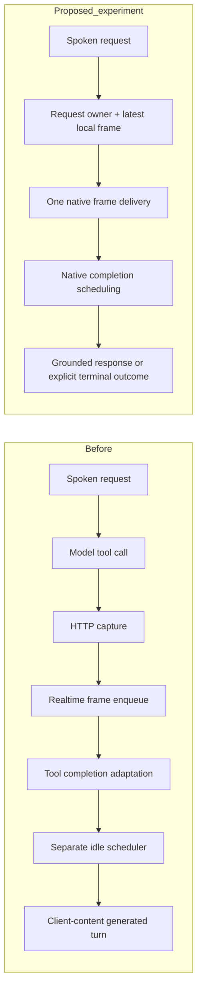

# Proposed plan — approval required before implementation

This is a provisional, evidence-led roadmap. Remaining audit coverage is explicitly listed in 01/04; approval should not be interpreted as confirmation that those gaps are closed. No application changes or paid probes were made in this audit.

## Target
INFERRED recommendation: voice remains the primary session; preserve local capture and on-request upload. Introduce a single bounded visual-request lifecycle with source/frame/turn identity. Prefer native Live video and one native completion mechanism if an actual-pixel probe confirms grounding. Retain the current implementation as the default until that experiment succeeds.

The proposed right-hand path is an experiment, not a proven provider contract. If native completion cannot reliably use current pixels, retain an explicit scheduler or use separately grounded vision text; do not ship faster hallucinations.

## Ordered steps
1. **Complete evidence coverage and instrument request timing (S/M).** Files: telemetry, screen_tools, receiver, workflow, recovery, visual_replies, latency report. Add request ID, caller turn/epoch, frame ID/generation/revision, receive/decode/capture/enqueue/transport-send/tool-completion/scheduler-wait/first-grounded-audio milestones. Distinguish local enqueue from actual send; provider perception remains unknown. Tests: complete success/failure traces, no screenshot payload in metrics, correlation survives cancellation. Rollback: disable additional telemetry. Expected gain: attribution, not faster speech.
2. **Make visual completion total (S/M).** Files: visual_replies, turns, screen_tools. Every accepted request ends as answered, superseded, stopped, disconnected, timed out or failed. Relevant failure can be reported when voice is available; stop must suppress speech. Tests: busy indefinitely, ordinary follow-up, new share, newer question, worker disconnect and deadline. Rollback: flag defaults to existing behavior. Expected gain: remove unexplained silent outcomes; rate measured against accepted-request denominator.
3. **Local frame availability improvements (M).** Files: receiver/decoder/workflow. Refresh local cache early, retain codec dependencies, measure rather than assume the need for per-stream scheduling. Do not upload on speech onset alone. Tests: two streams, delayed keyframe, scroll, static share, decode slowdown, crop. Rollback: original cadence flag. Target: reduce requested-frame age below 500 ms when provider delivery is healthy; not a network guarantee.
4. **Native single-completion experiment (M/high risk).** Files: recovery/native_tools/parallel_tools/visual_replies and contract tests. Compare current scheduler with native WHEN_IDLE completion while preserving stop/epoch handling. Default old behavior. Tests: no duplicate generation, real SDK emitted message order, active speech, follow-up after image, fresh reconnect. Rollback: one flag; retain original path until pixel acceptance passes. Expected gain: potentially remove separate 200 ms quiet gate plus extra scheduling overhead; no justified total-latency guarantee.
5. **Bound lifetime state and profile context (S/M).** Files: parallel_tools, memory/context, archive/repository. Prune completed tool tombstones safely; profile bounded retrieval before changing ranking. Tests: late SDK updates, long sessions and bilingual relevance. Rollback: retain old retrieval behind flag. Expected gain: bounded state and predictable context work; not asserted as current main latency cause.
6. **Simplify after successful acceptance (M).** Remove only superseded visual scheduling/binding branches proven unnecessary. Keep pinned recovery adapter until exact-version reconnect tests establish a replacement. Update the single primary README, preserving dated reports as history.

## Screen latency budget
VERIFIED before: 0–200 ms refresh and at least 200 ms idle quiet condition, up to a 30 s scheduler deadline; historical median decode 48.53 ms. Other stages have no trustworthy current baseline.

INFERRED targets after instrumentation: local capture+serialization p95 under 250 ms on this machine for cached non-cropped frames; scheduler overhead under 250 ms when voice is idle; no more than 500 ms regression on the next ordinary voice question. Provider grounding/generation and Recall playback remain measured variables, not promised budgets. Report first grounded answer separately from acknowledgment. Do not add historical retrieval median to current decode median to invent an end-to-end estimate.

## Cost and quality
Default sends no additional unrequested images. Short requested visual windows or extra frames require explicit opt-in and a cap; never enable continuous video silently. Preserve high-detail crops for text, aspect ratio and presenter identity. If no fresh frame exists, state that fact briefly; do not claim to see a blurry screen without pixels. A generation change invalidates pending evidence; an ordinary content revision can be reported as the captured snapshot rather than endlessly restarting.

## Minimal live probe — separately approval-gated
Proposal only: one consenting test session, at most three requested synthetic images with randomized codes/shapes, each followed by an ordinary spoken arithmetic question; include one share change and one stop case. No Tavily/search/chat posting. Cap runtime at five minutes, three image sends and one reconnect exercise only if explicitly included in approval. Record capture-to-send, question-end-to-grounded-audio, pixel accuracy, follow-up latency, provider usage and failure reason. Compare with identical offline encoded fixtures first.

Expected cost is nonzero and not yet quantified: image/audio model usage plus active Recall/LiveKit session charges. Before approval, calculate the ceiling from actual current account rates and runtime limits. This audit does not authorize the probe. Synthetic TEXT-description probes are insufficient substitutes.

## What stays
Keep the working website voice path, Zubenelgenubi voice/persona, audio rates, wake/follow-up/stop semantics, async research/chat, SQLite for current single-process scale, and on-request image policy. There is no measured case for rewriting LangGraph, adding Redis/vector search, permanently streaming screens, reducing VAD silence, or replacing the provider stack now.

## Questions for approval
- Approve completion of the outstanding read-only audit coverage before implementation, or prioritize instrumentation/terminal-state work first?
- Should an explicit 'watch this screen' request permit a short bounded visual stream until stop, while ordinary screen questions remain single snapshots?
- What maximum spend should a separately approved five-minute pixel probe use?

STOP: implementation awaits your approval, per the supplied mission's Phases 1–3 rule.
